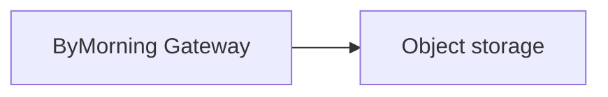

# Security review figures

One `.mmd` file per figure; `NN-M` belongs to document `NN` and is included with
`![[figure:NN-M]]`, followed by an italic caption line
(`_Figure NN-M — Title. Explanation._`). Figures are generic: they name no
customer, Region, or identity provider, and carry no placeholders. Where the
AWS and Azure installers differ, a figure uses a generic label (for example
"Gateway (ECS task or AKS pod)") and the table beside it carries the detail.

## Figures

| Figure | Document | Shows |
| ------ | -------- | ----- |
| `2-1`  | §2.2 | System context: users, identity provider, the Installation and its Code Interpreter in the customer's account, Bedrock, and optional external services |
| `2-5a` | §2.6, §10 | Data flow diagram, external boundaries B1 and B5–B9: clients, load balancer or ingress, Gateway, optional integrations |
| `2-5b` | §2.6, §10 | Data flow diagram, internal boundaries B2–B4: data plane, Bedrock, Code Interpreter sandbox |
| `3-1`  | §3.1 | CUI data flow: entry channels, processing, and stores |

## Shared classes

The renderer injects these classDefs into every flowchart
(`flowchart`/`graph`; sequence and pie diagrams do not support `classDef`).
Do not redefine them; apply them with a `class` statement:

| Class  | Meaning                                              | Style                  |
| ------ | ---------------------------------------------------- | ---------------------- |
| `bym`  | ByMorning process / component                        | blue fill              |
| `aws`  | Cloud-managed service (AWS or Azure)                 | orange fill            |
| `cust` | Customer-owned infrastructure (network, IdP)         | green fill             |
| `ext`  | Optional/external; disabled unless admin-enabled     | gray fill, dashed border |

Example:

## Readability budget

The PDF content column is 672 CSS px wide and ~9.5in tall (Letter, 0.75in
margins). Figures render at their natural width capped at the column, and tall
figures are capped at 8.8in of height so a figure plus its caption always fits
one page. Mermaid renders at a 17px base font, so the effective print size is
`17px × scale × 0.75` with `scale = min(1, 672/width, 845/height)`; the build
fails (`figure-scale`) when that drops below 8.5pt, i.e. when a portrait
figure exceeds ~1000px of natural width or ~1260px of natural height. Prefer
`flowchart TB` layering, break long labels with ` ` at logical points, and
keep edge labels short (`443 SigV4`, not a sentence) — detail belongs in the
table beside the figure. A per-figure
`%%{init: {"flowchart": {"wrappingWidth": …, "rankSpacing": …}}}%%` trades
width for height when the graph is taller than it is wide. The renderer sets
`padding: 12` and a `subGraphTitleMargin` so a subgraph title never sits under
its top-most node; do not override those.

The package deliberately carries few figures (the four above). Prefer a table
or paragraph over a new figure, and prefer a portrait figure over a landscape
page. The reference deployments in §2.4 are compared in a table rather than a
topology figure.

A genuinely wide figure can take a dedicated landscape page instead:
`![[figure:<id> landscape]]` in the document. The landscape content column is
~912 CSS px, so the same 8.5pt floor allows ~1290px of natural width. Use it
sparingly; prefer splitting or restructuring first.

The renderer's check fails on any mermaid label whose content overflows its
box and on any table, pre, or figure wider than the content column.
