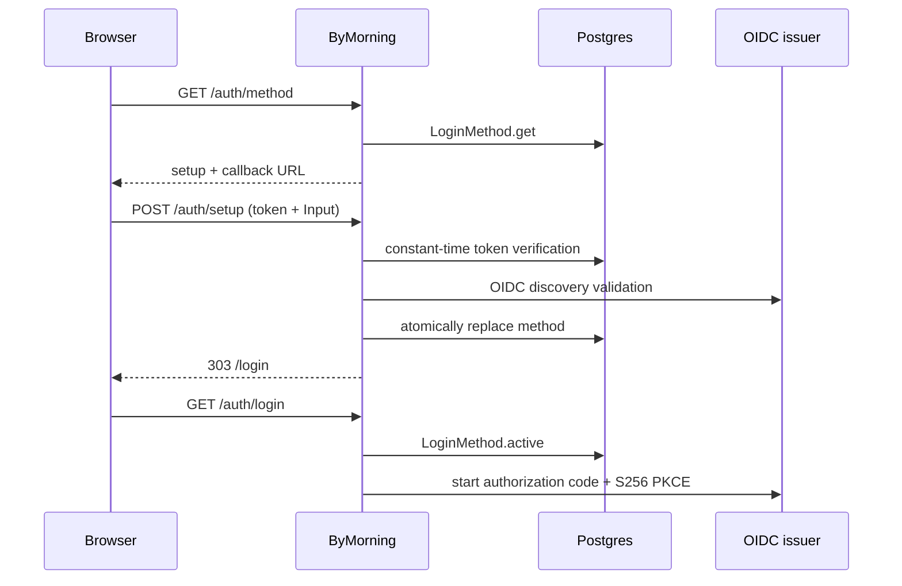

# Login Method — implementation spec

> The single-active-method domain rule below was superseded on 2026-09-11.
> The login target is now an Auth Provider (not Login Method); identity is a
> Subject and Linked Subject. See [Auth Provider](auth-provider.md) and
> [Auth module](auth-module.md). References below to the former `owner` role
> also predate the current `admin` role.

Status: approved. This replaces deployment-time OIDC configuration with one
Installation-owned, UI-configured Login Method. Breaking removal of the listed
authentication environment variables is authorized.

## 1. Goal

An Installation has zero or one active standard OpenID Connect Login Method. Before
one exists it is in Setup. ByMorning creates and retains a recovery setup token in
Postgres, logs it at every pending-Setup boot, and accepts it to install the first
method. A Workspace owner can subsequently replace the method without a deployment.

The method stores its display name, guidance preset, issuer, confidential client
credentials, and admitted email domains. The preset is presentation guidance only:
Okta, Microsoft Entra, Google Workspace, Auth0, Ping, and Custom use exactly the
same OIDC authorization-code-with-PKCE protocol.

## 2. Authority and lifecycle

| Authority | Owner | Decides |
| --- | --- | --- |
| Installation setup state and recovery token | `LoginMethod` | whether an active method exists; token creation and verification |
| Login Method record | `LoginMethod` | validation, discovery, atomic replacement, secret containment |
| Person verification | configured OIDC issuer | identity, MFA, assignment, IdP lifecycle |
| Browser OIDC exchange | `WebProvider.dynamic` | per-method discovery, PKCE, token validation, claims |
| Account decision | `Auth.resolve` | domain admission, Identity linking, conflicts, provisioning |
| Workspace authorization | membership | whether the current User has the owner role |

`LoginMethod` earns a Core seam: deleting it would distribute setup-token lifecycle,
single-record consistency, confidential secret handling, discovery admission, and
replacement semantics among handlers, hosts, and the web provider. It is not Auth:
Auth consumes the current domains when resolving an assertion, while Login Method
owns the configured external verification mechanism.



## 3. Core contract

`packages/core/src/login-method.ts` is the sole public Core entrypoint; its private
implementation is under `packages/core/src/login-method/`.

```ts
export * as LoginMethod from "./login-method.js"

export const Preset = Schema.Literals(["okta", "microsoft", "google", "auth0", "ping", "custom"])
export const Domain: Schema.Schema<Domain>
// bare lower-case /^[a-z0-9.-]+$/ domain; permits a single label or contains a dot;
// input normalises by trim and lower-case.

export const Info = Schema.Struct({
  preset: Preset,
  displayName: Schema.NonEmptyString,
  issuer: Schema.URL,
  clientID: Schema.NonEmptyString,
  domains: Schema.NonEmptyArray(Domain),
  updatedAt: DateTimeUtc,
})
export const Input = Schema.Struct({
  preset: Preset,
  displayName: Schema.NonEmptyString,
  issuer: Schema.URL,
  clientID: Schema.NonEmptyString,
  clientSecret: Schema.Redacted(Schema.NonEmptyString),
  domains: Schema.NonEmptyArray(Domain),
})
export interface Active extends Info { readonly clientSecret: Redacted.Redacted<string> }

export class InvalidError extends Schema.TaggedError("LoginMethod.InvalidError", {
  field: Schema.Literals(["issuer", "clientID", "clientSecret", "domains", "displayName"]),
}) {}
export class DiscoveryError extends Schema.TaggedError("LoginMethod.DiscoveryError", {
  reason: Schema.Literals(["unreachable", "issuer-mismatch", "incomplete", "no-code-grant", "no-s256"]),
}) {}
export class TokenError extends Schema.TaggedError("LoginMethod.TokenError", {}) {}

export interface Interface {
  readonly get: () => Effect.Effect<Option.Option<Info>>
  readonly active: () => Effect.Effect<Option.Option<Active>>
  readonly register: (input: Input) => Effect.Effect<Info, InvalidError | DiscoveryError>
  readonly setup: (input: { readonly token: Redacted.Redacted<string> } & Input) => Effect.Effect<
    Info,
    TokenError | InvalidError | DiscoveryError
  >
  readonly init: () => Effect.Effect<void>
}
export class Service extends Context.Service<Service, Interface>()("@bymorning/core/LoginMethod") {}
```

`Info` and every HTTP projection exclude `clientSecret`; errors and logs exclude it
and the setup token. `Active` is intentionally internal-consumer data returned only
through this service. `Preset`, `Domain`, `Info`, and `Input` must be exported in the
Core namespace for protocol reuse; no caller imports `login-method/**`.

### 3.1 Guarantees

| Operation | Guarantee | Expected failure |
| --- | --- | --- |
| `init` | Creates one 32-random-byte base64url setup token only if missing; repeat calls and restarts retain it. If no method exists, logs exactly `Login Method setup pending. Setup token: <token>` once per process boot after initialization. | persistence defects die as Core persistence failures |
| `get` | Returns secret-free `None` or the current `Info`. | — |
| `active` | Returns `None` or current `Info` plus redacted secret. | — |
| `register` | Validates input and OIDC discovery, then atomically replaces the single method row. | `InvalidError`, `DiscoveryError` |
| `setup` | Constant-time compares the supplied token, then has exactly `register` replacement semantics. It works both for first setup and recovery replacement. | `TokenError`, `InvalidError`, `DiscoveryError` |

There is one `login_method` row, enforced by a fixed singleton primary key/check;
replacement is one transaction, never a delete followed by an independently visible
insert. `installation_setup` likewise has one singleton row. The retained token is
valid forever, including after a successful setup, deliberately providing recovery.

Input validation rejects an empty display name/client ID/secret/domain list, invalid
domain values, and issuers that are not HTTPS or contain credentials, query, or
fragment. Preserve an issuer path (required by Entra). Normalization occurs before
storage and output: domain trim/lowercase and a copied canonical URL.

Discovery uses the exact configured issuer and requires exact issuer equality plus
`authorization_endpoint`, `token_endpoint`, and `jwks_uri`. It requires
`response_types_supported` to include `code`; when
`code_challenge_methods_supported` is present it must contain `S256`. Map unreachable
transport/fetch failure to `unreachable`, issuer disagreement to `issuer-mismatch`,
missing endpoints to `incomplete`, absent code response type to `no-code-grant`, and
present PKCE metadata without S256 to `no-s256`.

### 3.2 Private dependencies and composition

| Private module | Responsibility |
| --- | --- |
| `login-method/store.ts` | Drizzle persistence and singleton transactional replacement |
| `login-method/discovery.ts` | `oauth4webapi` discovery fetch and contract validation |
| `login-method/token.ts` | random token creation and constant-time comparison |

Add `login_method` and `installation_setup` Drizzle definitions alongside
`packages/core/src/database/schema/*.sql.ts`; generate one forward-only migration in
`packages/core/src/database/migration/` from `packages/core` with
`bunx sst shell --stage <stage> -- bun db generate --name login_method`.
The current repository has schema definitions but no committed migration directory,
so create it as part of the forward migration rather than assuming an existing naming
convention.

Add `oauth4webapi` to the root catalog and `packages/core/package.json` (Core does not
currently declare it). Discovery uses the Core `HttpClient` dependency using the same
`LayerNodePlatform.httpClient` binding pattern as `LLMGateway`; token work uses the
Core Crypto capability/binding rather than a host implementation. `LoginMethod.layer`
composes Database, HttpClient, and Crypto. `LoginMethod.node` is its global Node
binding. In `Application.process`, bind it with those dependencies and include
`loginMethod.init` in `root` beside Storage initialization and `WorkspaceRecovery.boot`.

## 4. Existing-seam changes

### 4.1 Auth domains

Change `Auth.makeNode(deps, domains)` from `ReadonlyArray<string>` to
`Effect.Effect<ReadonlyArray<string>>`. `layerWith` captures this effect and evaluates
it for each `Auth.resolve`; `resolve` otherwise remains unchanged. AWS binds
`LoginMethod.active` mapped to its domains (none is `[]`, therefore every external
login is refused as existing `RejectedError` reason `email-domain`). Local binds
`Effect.succeed(config.application.allowedEmailDomains)`. Remove the app-level static
domain setting from deployed composition. `Settings.allowedEmailDomains` becomes
optional only for local compatibility; it is not an AWS configuration input.

### 4.2 Dynamic Web Provider

Keep static `WebProvider.layer(config)` for focused tests and its unchanged public
`Interface`. Add:

```ts
export const dynamic: Layer.Layer<WebProvider.Service, never, LoginMethod.Service>
export const dynamicNode: LayerNode.Unbound<WebProvider.Service, WebProvider.Interface, typeof tags.values.global>
```

`dynamic.start` and `dynamic.complete` call `LoginMethod.active` on every invocation.
`None` fails `ProviderError` with `reason: "unconfigured"`; add that literal to
`Reason`. Cache OIDC clients/discovery by `(issuer.href, clientID, updatedAt)` so a
replacement takes effect without restart while unchanged calls share protocol state.
Build the static OIDC adapter from the active record; set `Auth.Provider` on its
assertions from `preset`. The active secret never enters logs/cache keys. AWS selects
`WebProvider.dynamicNode`; `app/local` retains `LocalWebProvider`.

### 4.3 HTTP protocol and handlers

Add `packages/protocol/src/groups/login-method.ts` and include it in `api.ts` as a
public auth group plus account/workspace-protected API groups as appropriate. Reuse
the Core schemas, or a secret-safe wire schema where necessary. The contract is:

| Endpoint | Middleware | Input/output | Errors |
| --- | --- | --- | --- |
| `GET /auth/method` | public | `{ state: "setup" \| "ready", displayName?: string, preset?: Preset, callbackURL: string }` | normal transport failures |
| `POST /auth/setup` | public | `{ token, ...Input }`; success empty 303 to `/login` | `TokenError` → 403; `InvalidError`/`DiscoveryError` → typed 422 |
| `GET /api/login-method` | Account middleware | `Option<Info>` | session errors |
| `PUT /api/login-method` | Workspace middleware | `Input` → `Info` | owner-only `ForbiddenError`, validation/discovery 422 |

The handler obtains the current role from `CurrentActor` (`UserActor.properties.role`)
provided by `workspaceMiddlewareLayer`; `admin` and `member` receive the existing
`ForbiddenError` (not a new authorization error). The PUT's workspace query remains
the standard `WorkspaceQuery`, even though Login Method is Installation-owned: the
selected Workspace establishes the authorized owner. GET uses Account middleware, not
Workspace middleware. Setup returns no token or secret. Add handlers to the ordinary
server `handlers` layer and route API composition.

After changing Protocol run `bun run --filter @bymorning/client generate`, then
Protocol/client typechecks and `check:generated`; `packages/protocol`'s OpenAPI command
is `bun run generate`. Commit generated clients and `openapi.json` together.

### 4.4 Hosts, configuration, and docs

`serverConfig` retains only `appOrigin`; delete its EmailDomains codec and auth fields.
If no remaining consumer needs the file, delete it and read `APP_ORIGIN` in AWS instead.
`Application.Config` stays otherwise unchanged; its deployed domain source is the
LoginMethod effect described above. In `app/aws`, use `WebProvider.dynamicNode`, remove
`allowedEmailDomains` from Settings, and bind LoginMethod node/database/HTTP/Crypto.

Remove `AUTH_ISSUER`, `AUTH_CLIENT_ID`, `AUTH_CLIENT_SECRET`, `AUTH_PROVIDER`,
and `AUTH_EMAIL_DOMAINS` from `infra/server.ts`, service links and environment.
Keep `APP_ORIGIN`, `WEB_COOKIE_KEY`, and `BYMORNING_API_KEY`. Update README's secret
section accordingly. Rewrite `docs/guides/identity-provider-setup.md` to tell operators
to register the IdP callback then enter values in Setup or Settings → Security, not
`sst secret set`.

`app/local` still binds `LocalWebProvider`; it also binds LoginMethod node so `init`
runs. Its pending-Setup token log is harmless and remains emitted; the local UI hides
Setup and continues to offer only Continue locally.

## 5. Web application

Register `/settings/security` in the existing router beside the other authenticated
workspace routes. Use `SecurityRoute`, `LoginSetup`, and `LoginMethodForm` components
under the established `settings/` and `login/` folders, with local route CSS using the
existing `data-component`/`data-slot` convention. Do not create hand-written SDK types:
use regenerated methods from `useSDK()`.

`LoginRoute` behavior. One web build serves every deployment: the route always
fetches `/auth/method` and decides at runtime from its response; there is no
compile-time sign-in flag.

| State | Render/action |
| --- | --- |
| loading | accessible pending state (**Loading sign-in options…**); never assume a configured provider |
| error | neutral **Continue** link to `/auth/login`; the method cannot be named without a response |
| `setup` | `LoginSetup`: token plus preset picker and guided `LoginMethodForm`; POST `/auth/setup`; on 303 show **Sign in** |
| `ready`, `local` only (no providers, no `banner`, not `?auth=failed`) | continue to `/auth/login` without rendering the card |
| `ready`, otherwise | one sign-in button per provider using its `displayName`; a **Continue locally** link when `local`; a configured `banner` gates every action on acknowledgment |

The picker has six cards. The form exposes display name (prefilled per preset), client
ID, password-type client secret, comma-separated domains, and read-only callback URL.
Google prepopulates and locks `https://accounts.google.com`. Microsoft collects Tenant
ID and derives `https://login.microsoftonline.com/<tenant>/v2.0`; Okta collects org URL;
Auth0 derives `https://<tenant>.auth0.com/`; Ping and Custom expose a free issuer. The
secret is never fetched, rendered, or prefilled.

`SecurityRoute` is visible only when the currently selected actor role is `owner`, using
the Members route's role-gating pattern. It displays a **SSO Connection** card with
preset, display name, issuer, client ID, and domains, or “No SSO connection configured
yet”. **Configure SSO** opens the same picker/form and PUTs `/api/login-method` with
the selected Workspace. Refetch its secret-free GET result after success.

## 6. Configuration reference

| Name | Kind | Consumer | Meaning |
| --- | --- | --- | --- |
| `APP_ORIGIN` | host configuration | handlers/UI | public origin and `${APP_ORIGIN}/auth/callback` |
| `WEB_COOKIE_KEY` | secret | WebCookie | cookie encryption key |
| `BYMORNING_API_KEY` | secret | API ingress | deployment API authentication |
| setup token | generated Postgres plaintext | `LoginMethod` | durable Setup and recovery proof; never API/logged except pending boot line |
| client secret | Postgres plaintext | `LoginMethod`/WebProvider | OIDC confidential-client credential; never API/log |

Plaintext database fields rely on RDS encryption at rest. Setup token/client-secret
rotation is a Login Method replacement, not a redeploy. IdP registration remains a
confidential web client with authorization-code grant, `openid email profile`, and the
shown callback URL.

## 7. Tests

All persistence behavior uses real Postgres fixtures and public services, not store
imports or module mocks.

| Area | Coverage |
| --- | --- |
| Core LoginMethod | register validation/replacement; normalized domains; `Info` excludes secret; all InvalidError fields; wrong setup token; idempotent stable token across restart; discovery unreachable, issuer mismatch, incomplete, no-code-grant, no-s256 |
| WebProvider.dynamic | unconfigured failure; replacement detected without restart; full authorization flow |
| handlers | `/auth/method` setup/ready; setup success, bad token, discovery failure; GET needs account session; PUT refuses admin/member and permits owner |
| harness | blank DB reads token via LoginMethod service, POSTs setup to fixture, signs in, calls SDK, replaces as owner with a second fixture, signs in again |
| web | local/setup/ready login states; Security Info rendering and owner visibility; preset issuer templates; secret never prefilled |
| migration | generated forward-only migration applies to blank and existing fixture databases |

Move `packages/server/test/oidc-idp.ts` to `packages/testing/src/oidc-idp.ts`. It is a
shared real network fixture, and `packages/testing` already depends on server source;
making Core tests import Testing would reverse that dependency. Instead expose the
fixture from Testing and make Core integration tests run it through a test-only shared
workspace dependency (or move it further to a neutral `packages/testing` package export
available as a dev dependency), avoiding any Core → Server cycle. Extend fixture
`Options`/`discoveryNext` with missing-endpoint and missing-response-type modes; retain
issuer mismatch, closed-server, and `advertisePKCE: false` (the latter must instead
advertise a non-S256 list to exercise `no-s256`, because omitted metadata is allowed).

Existing `TestIdentity` scenarios no longer pass static domains to `TestApp.make`.
Their scenario setup registers a Login Method through `LoginMethod.Service` before
external authentication, or TestApp's local identity path supplies its existing local
domain effect explicitly. No test bypasses the public registration service.

Focused verification: `bun run test` and `bun run typecheck` in core, server, testing,
web, and app/aws; Protocol/client generation checks above; run the application browser
suite from `packages/web`.

## 8. Implementation order

1. **This phase:** glossary and this approved spec.
2. Core LoginMethod, schema/migration, and tests; relocate and extend OIDC fixture.
3. Auth dynamic domains effect. *(parallel with 2 after contract stubs)*
4. WebProvider.dynamic and adapter tests. *(after 2)*
5. Protocol group, generation, handlers, and handler tests. *(after 2/4)*
6. Hosts, infrastructure, config, README, and identity-provider guide cleanup. *(after 3–5)*
7. Web Setup login and Security route plus tests. *(parallel with 6 after 5 client generation)*
8. Harness scenario and complete focused verification.

## 9. Trade-offs

- One active Login Method makes setup and recovery simple; replacement preserves
  Accounts and Identities but a changed IdP can require normal Auth conflict handling.
- The token and client secret are plaintext Postgres values, relying on RDS encryption
  at rest; neither crosses an API response or ordinary log boundary.
- Any Workspace owner can replace the Installation-wide method. Every self-provisioned
  Account owns its default Workspace, so this is effectively any signed-in user. The
  cheapest future tightening is owners of the Workspace whose owner completed Setup.
- The permanent setup token intentionally prioritizes recovery over one-time bootstrap
  secrecy; operators must treat the pending-Setup log value as a credential.
- Local host retains Local Login and hides Setup; its harmless pending token log means
  local development does not need a configured external IdP.
