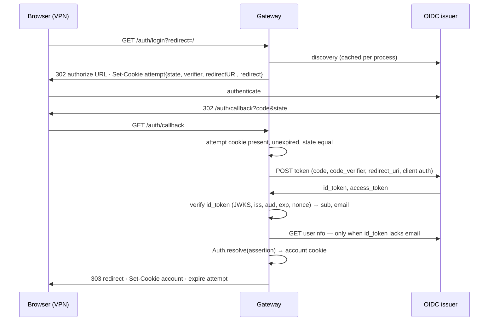

# OIDC Login — implementation spec

Status: approved. Breaking changes to browser authentication are authorized; the
OpenAuth client and the `packages/auth` library port are removed.

## 1. Goal

ByMorning runs as an internal application in one AWS account behind a VPN-only load
balancer. Browser sign-in is delegated to the enterprise identity provider through
standard OpenID Connect (authorization code + PKCE, confidential client). Any IdP
that publishes `/.well-known/openid-configuration` and supports the code grant with
a client secret works: Okta, Microsoft Entra ID, Google Workspace, Auth0, Keycloak,
Ping, OneLogin, JumpCloud, Cognito, Authentik, Dex. IAM Identity Center is SAML-only
for custom applications and is reached through an optional Cognito bridge that
presents as an ordinary OIDC issuer.

Per-deployment configuration: issuer URL, client ID, client secret, provider label,
and the allowed email domains.

## 2. Authority

| Authority                 | Owner                            | Decides                                                                               |
| ------------------------- | -------------------------------- | ------------------------------------------------------------------------------------- |
| Verifying the person      | Corporate IdP                    | Who the person is, MFA, assignment, offboarding                                       |
| Running the OIDC exchange | `WebProvider` (server)           | Discovery, PKCE, state, nonce, code exchange, ID-token verification, claim extraction |
| Deciding the Account      | `Auth.resolve` (Core, unchanged) | Email-domain admission, Identity linking, conflict refusal, provisioning              |
| Browser session           | `WebCookie` + `handlers/auth.ts` | Encrypted account cookie, lifetime from `WebCookie.Policy`                            |

`CONTEXT.md` needs no change: Issuer, Login Method, Assertion, Identity, and Local
Login already describe this arrangement.

## 3. Flow



## 4. Contracts

### 4.1 `packages/server/src/web-provider.ts` — changed internals, extended config

```ts
export * as WebProvider from "./web-provider.js"

export interface Config {
  /** Label stored on Identity links and used for display, e.g. "okta". Immutable per deployment. */
  readonly provider: Auth.Provider
  /** Exact OIDC issuer identifier. https only; a path is permitted (Entra: /<tenant>/v2.0). */
  readonly issuer: URL
  readonly clientID: string
  readonly clientSecret: Redacted.Redacted<string>
  /** Additional scopes. "openid" is always requested; default adds "email" and "profile". */
  readonly scopes?: ReadonlyArray<string>
}

export class ConfigError extends Schema.TaggedError<ConfigError>()("WebProvider.ConfigError", {}) {}

export const Reason = Schema.Literals(["discovery", "authorization", "exchange", "token", "claims", "userinfo"])
export type Reason = typeof Reason.Type

export class ProviderError extends Schema.TaggedError<ProviderError>()("WebProvider.ProviderError", {
  operation: Schema.Literals(["start", "complete"]),
  reason: Reason,
  /** OAuth token-endpoint error code only; never an IdP description or response body. */
  code: Schema.optionalKey(Schema.String),
}) {}

export interface StartResult {
  readonly redirect: URL
  readonly provider: Auth.Provider
  readonly state: Redacted.Redacted
  readonly verifier: Redacted.Redacted
}

export interface Interface {
  readonly start: (redirectURI: URL) => Effect.Effect<StartResult, ProviderError>
  readonly complete: (input: {
    readonly code: Redacted.Redacted
    readonly verifier: Redacted.Redacted
    readonly redirectURI: URL
  }) => Effect.Effect<Auth.Assertion, ProviderError>
}

export class Service extends Context.Service<Service, Interface>()("@bymorning/server/WebProvider") {}

/** Standard OIDC confidential-client adapter. Discovery is lazy; construction never performs I/O. */
export const layer: (config: Config) => Layer.Layer<Service, ConfigError>
export const configured: (config: Config) => GlobalProvider<Service, never>
export const node: LayerNode.Unbound<Service, Interface, typeof tags.values.global>
```

Validation at construction (`ConfigError`): issuer protocol `https:`, empty
username/password/search/hash; `clientID` non-empty; `clientSecret` non-empty;
`provider` is not `email` or `local`.

`start(redirectURI)` guarantees:

| Guarantee                                                                                                                                                                                                                                   | Else            |
| ------------------------------------------------------------------------------------------------------------------------------------------------------------------------------------------------------------------------------------------- | --------------- |
| Discovery fetched from `{issuer}/.well-known/openid-configuration`; `issuer` in the document equals `config.issuer.href` without trailing slash normalisation beyond the spec; cached after the first success; a failed fetch is not cached | `discovery`     |
| Discovery advertises `authorization_endpoint`, `token_endpoint`, `jwks_uri`, and `code_challenge_methods_supported` including `S256` (absent list is accepted per spec)                                                                     | `discovery`     |
| Fresh `state` (≥ 32 random bytes, base64url) and PKCE `verifier` (43–128 chars) per call                                                                                                                                                    | —               |
| `nonce` = base64url(SHA-256(verifier)); `code_challenge` = S256(verifier)                                                                                                                                                                   | —               |
| Redirect URL is the `authorization_endpoint` with `response_type=code`, `client_id`, `redirect_uri`, `scope`, `state`, `nonce`, `code_challenge`, `code_challenge_method=S256`                                                              | `authorization` |

`complete({ code, verifier, redirectURI })` guarantees:

| Guarantee                                                                                                                                                                                                                                                                                                                                   | Else        |
| ------------------------------------------------------------------------------------------------------------------------------------------------------------------------------------------------------------------------------------------------------------------------------------------------------------------------------------------- | ----------- |
| Token request to `token_endpoint` with `grant_type=authorization_code`, `code`, `code_verifier`, `redirect_uri`; client authentication is the first advertised supported method in discovery order (`client_secret_post` or `client_secret_basic`), defaults to `client_secret_basic` when omitted, and refuses a present list with neither | `discovery` |
| Response contains `id_token`; token-endpoint error responses fail                                                                                                                                                                                                                                                                           | `exchange`  |
| ID token signature verified against `jwks_uri` (keys cached; unknown `kid` refetches once); `iss` equals configured issuer; `aud` contains `clientID` (and `azp` equals it when several audiences); `exp` in the future with ≤ 60 s skew; `nonce` equals base64url(SHA-256(verifier))                                                       | `token`     |
| RFC 9207 authorization-response `iss` check skipped because a single configured issuer makes mix-up attacks inapplicable; ID token `iss` remains verified (§8)                                                                                                                                                                              | —           |
| `sub` non-empty                                                                                                                                                                                                                                                                                                                             | `claims`    |
| `email` taken from the ID token; when absent, `userinfo_endpoint` is called with the access token and its `sub` must equal the ID token `sub`                                                                                                                                                                                               | `userinfo`  |
| `email` decodes as `Auth.Email`                                                                                                                                                                                                                                                                                                             | `claims`    |
| Result `Auth.Assertion.make({ provider, subject: sub, verifiedEmail: email })`; access/refresh tokens discarded                                                                                                                                                                                                                             | —           |

The result's `emailVerified` is true when `email_verified` is `true`, or when `xms_edov` is `true` and the email came from the ID token (Microsoft Entra omits `email_verified`); an explicit `email_verified: false` always wins. Errors carry no IdP text; the handler logs
`operation` and `reason` only.

Implementation dependency: `oauth4webapi` (added to the root catalog). It uses the
global `fetch` and WebCrypto, as the removed OpenAuth client did.

### 4.2 `packages/server/src/web-cookie.ts` — policy gains the session lifetime

```ts
export interface Policy {
  readonly accountName: string
  readonly attemptName: string
  readonly secure: boolean
  /** Account cookie and payload lifetime. */
  readonly sessionLifetime: Duration.DurationInput
}

export const secure = {
  accountName: "__Host-bm_auth",
  attemptName: "__Secure-bm_auth_attempt_v1",
  secure: true,
  sessionLifetime: "12 hours",
} satisfies Policy

export const local = {
  accountName: "bm_local_auth",
  attemptName: "bm_local_attempt",
  secure: false,
  sessionLifetime: "30 days",
} satisfies Policy
```

`Attempt`, `Account`, `Value`, `Service`, encryption: unchanged.

### 4.3 `packages/server/src/handlers/auth.ts` — lifetime from policy

`authHandler(appOrigin, policy)` replaces the two literal `"30 days"` values with
`policy.sessionLifetime` for both the `maxAge` and the encrypted `expiresAt`. Logs
on callback failure add `reason` when the failure is a `ProviderError`. No other
behaviour change; routes, status codes, redirect validation, and cookie attributes
are unchanged.

### 4.4 `packages/server/src/server-config.ts` — deployment settings

```ts
/** Comma-separated bare domains, lower-cased and trimmed; at least one. */
export const EmailDomains: Schema.Codec<ReadonlyArray<string>, string>

/** Parsed authentication settings owned by the Server composition root. */
export const serverConfig: Config.Config<{
  readonly appOrigin: URL
  readonly issuer: URL // AUTH_ISSUER, https, path allowed
  readonly clientID: string // AUTH_CLIENT_ID
  readonly clientSecret: Redacted.Redacted<string> // AUTH_CLIENT_SECRET
  readonly provider: Auth.Provider // AUTH_PROVIDER
  readonly emailDomains: ReadonlyArray<string> // AUTH_EMAIL_DOMAINS
}>
```

### 4.5 `packages/server/src/application.ts` — identity is always host-selected

```ts
export interface Config {
  readonly configuration?: readonly ConfigSchema.Entry[]
  readonly appOrigin: URL
  readonly allowedEmailDomains?: readonly string[]
  readonly cookiePolicy?: WebCookie.Policy
  readonly directory?: string
  readonly installPackage?: boolean
}
```

`issuer`, `clientID`, `provider`, and `requireProvider` are removed.
`Dependencies.identity` is required; `process(config, deps)` no longer has a default
identity binding. `Settings` is unchanged.

### 4.6 Hosts

`app/aws/src/index.ts`

- `settings.allowedEmailDomains = auth.emailDomains` (was the literal `["bymorning.ai"]`).
- `identity: WebProvider.configured({ provider, issuer, clientID, clientSecret })`.

`app/local/src/index.ts` and `config.ts`: unchanged (`LocalWebProvider`, `WebCookie.local`).

### 4.7 `packages/web/src/login/route.tsx` — button label

> Superseded: the compile-time `VITE_LOCAL_LOGIN` flag was removed so one web
> build serves every deployment. The route reads `local` and `providers` from
> `/auth/method` at runtime; **Continue locally** appears only when the response
> reports `local`, and the label when that response is unavailable is a neutral
> **Continue**. See [Login Method](login-method.md) §5.

The OIDC label is fixed so deployments do not need a presentation-only build setting.

### 4.8 Test fixture — `packages/server/test/oidc-idp.ts`

A real local IdP shared by server tests and `packages/testing`.

```ts
export interface IdentityToken {
  readonly sub: string
  readonly email?: string
  readonly extra?: Record<string, unknown>
}

export interface Options {
  /** Default: the server's own origin. Set to a different value to provoke `discovery` failure. */
  readonly issuer?: string
  /** Default: "client_secret_basic" and "client_secret_post". */
  readonly tokenAuthMethods?: ReadonlyArray<"client_secret_basic" | "client_secret_post">
  /** Default: true. false omits `code_challenge_methods_supported`. */
  readonly advertisePKCE?: boolean
}

export interface AuthorizeRequest {
  readonly params: URLSearchParams
}

export interface Issued {
  /** The `code` handed to the browser redirect. Single use. */
  readonly code: string
  readonly redirect: URL
}

export interface Fixture {
  readonly issuer: URL
  readonly clientID: string
  readonly clientSecret: string
  /** Simulate the browser completing sign-in at the IdP for the given authorize URL. */
  readonly authorize: (url: URL, identity: IdentityToken) => Promise<Issued>
  /** Requests observed at /authorize, in order. */
  readonly authorizeRequests: ReadonlyArray<AuthorizeRequest>
  /** Rotate to a fresh signing key; previously issued tokens become unverifiable. */
  readonly rotateKeys: () => Promise<void>
  /** Sign the next ID token with a key not present in the JWKS. */
  readonly signNextWithUnknownKey: () => void
  /** Override claims on the next ID token (e.g. wrong iss/aud/nonce/exp). */
  readonly tamperNext: (claims: Record<string, unknown>) => void
  /** Fail the next userinfo call (500) or return a different sub. */
  readonly userinfoNext: (mode: "fail" | "sub-mismatch") => void
  readonly close: () => Promise<void>
}

export const start: (options?: Options) => Promise<Fixture>
```

Endpoints: `/.well-known/openid-configuration`, `/jwks`, `/authorize`, `/token`,
`/userinfo`. RS256 keys generated with `node:crypto`; tokens signed without external
libraries. `/token` enforces: known single-use `code`, `redirect_uri` equality,
S256(`code_verifier`) equals the recorded `code_challenge`, and client
authentication per `tokenAuthMethods`. ID tokens include `iss`, `sub`, `aud`, `exp`,
`iat`, `nonce`, and `email` when supplied.

### 4.9 Infrastructure — `infra/server.ts`

- New `sst.Secret("AUTH_CLIENT_SECRET")`, `sst.Secret("AUTH_EMAIL_DOMAINS")`;
  both linked and passed as environment to the gateway service.
- Everything else auth-related unchanged. The VPN-only shape (internal HTTPS load
  balancer, NAT egress, removal of CloudFront `Router`/`StaticSite`, gateway serving
  the web build) is a separate deployment change and is not part of this spec.

### 4.10 Removals

| Removed                                                               | Follow-up                                                                  |
| --------------------------------------------------------------------- | -------------------------------------------------------------------------- |
| `@openauthjs/openauth` (root catalog, `packages/server/package.json`) | `bun install`                                                              |
| `packages/auth/**`                                                    | root `test:auth` script; `jose` catalog entry if no other consumer remains |
| `packages/server/src/web-provider.test.ts` (mocked client)            | replaced by `web-provider.test.ts` against the fixture                     |
| `Application.Config.issuer/clientID/provider`, `requireProvider`      | `app/aws` passes the adapter explicitly (already does)                     |
| README secret list                                                    | add `AUTH_CLIENT_SECRET`, `AUTH_EMAIL_DOMAINS`                             |

## 5. Configuration reference

| Name                 | Kind            | Consumer                     | Meaning                                                                  |
| -------------------- | --------------- | ---------------------------- | ------------------------------------------------------------------------ |
| `AUTH_ISSUER`        | SST secret      | `WebProvider`                | OIDC issuer URL, exactly as the discovery document reports it            |
| `AUTH_CLIENT_ID`     | SST secret      | `WebProvider`                | Client ID registered at the IdP                                          |
| `AUTH_CLIENT_SECRET` | SST secret, new | `WebProvider`                | Client secret registered at the IdP                                      |
| `AUTH_PROVIDER`      | SST secret      | `WebProvider`, Identity link | Stable label, e.g. `okta`, `microsoft`; never change after first sign-in |
| `AUTH_EMAIL_DOMAINS` | SST secret, new | `Auth.resolve`               | Comma-separated admitted email domains                                   |
| `WEB_COOKIE_KEY`     | SST secret      | `WebCookie`                  | 32-byte base64url key                                                    |
| `APP_ORIGIN`         | infra-derived   | handler, `WebProvider`       | Callback is `${APP_ORIGIN}/auth/callback`                                |

IdP registration per deployment: web/confidential client, authorization-code grant,
scopes `openid email profile`, redirect URI `https://<app-host>/auth/callback`,
user/group assignment. Issuer values: Okta `https://<org>.okta.com` (or a custom
authorization server URL); Entra `https://login.microsoftonline.com/<tenant-id>/v2.0`
with the `email` optional claim enabled; others as reported by their discovery
document.

## 6. Tests

All through public interfaces against the real fixture; no module mocks.

`packages/server/src/web-provider.test.ts`

- config: rejects http issuer, credentials, query, fragment, empty client ID/secret,
  reserved provider labels; accepts a path.
- start: uses discovered `authorization_endpoint`; includes `code`, S256 challenge,
  default scopes plus configured extras, fresh `state`/`verifier` on each call;
  discovery issuer mismatch → `discovery`; discovery unreachable → `discovery` and a
  later successful call recovers; wrong-origin `authorization_endpoint` → `authorization`.
- complete: success returns provider/sub/email and no tokens; wrong verifier →
  `exchange`; reused code → `exchange`; `client_secret_post`-only IdP succeeds; unknown
  signing key → `token`; tampered `iss`/`aud`/`nonce`/expired → `token`; key rotation
  → refetch succeeds; missing `email` → userinfo path succeeds; userinfo `sub`
  mismatch or 500 → `userinfo`; malformed email → `claims`.

`packages/server` handler tests

- existing login/callback/logout tests continue to pass with `sessionLifetime`;
  add an end-to-end `/auth/login` → fixture → `/auth/callback` run asserting the
  account cookie `maxAge` equals the policy lifetime and redirect is honoured.

`packages/testing`

- one `TestApp.make` scenario with `WebProvider.configured` pointed at the fixture,
  completing sign-in through the real SDK and performing one authenticated call.
  Existing `TestIdentity` scenarios are unchanged.

`packages/web`

- login route renders "Continue with <provider>" per provider, "Continue locally" when
  `/auth/method` reports `local`, and a neutral "Continue" when that response is unavailable.

Commands: `bun run test` and `bun typecheck` in `packages/server`, `packages/testing`,
`packages/web`, `app/aws`; never from the root.

## 7. Implementation order

1. Add `oauth4webapi` to the catalog and `packages/server`; remove
   `@openauthjs/openauth`; delete `packages/auth`; `bun install`.
2. Build `packages/server/test/oidc-idp.ts`.
3. Rewrite `web-provider.ts` per §4.1 with its test.
4. `WebCookie.Policy.sessionLifetime`; handler uses it; handler tests.
5. `server-config.ts` (`AUTH_CLIENT_SECRET`, `AUTH_EMAIL_DOMAINS`); `Application.Config`
   cleanup; `app/aws` wiring; `app/aws/test/config.test.ts`.
6. `infra/server.ts` secrets and build arg; `Dockerfile` arg; web label; README.
7. `packages/testing` scenario.
8. Typecheck and tests per package.

## 8. Trade-offs

- Client secret lives in the container environment; rotation is a secret update
  plus redeploy.
- 12-hour session for deployed stages bounds post-offboarding access; users
  re-authenticate at most twice a working day, usually silently via the IdP session.
- Logout clears the ByMorning cookie only; no IdP single logout.
- One IdP per deployment; switching IdPs is a secret change, and existing Accounts
  are rejoined by verified email. The RFC 9207 `iss` authorization-response check is
  skipped because a single fixed issuer makes mix-up attacks inapplicable; the ID
  token's `iss` claim remains verified. Supporting more than one IdP per deployment
  changes this precondition: forward the callback `iss` query parameter through
  `CallbackQuery` into `WebProvider.complete` and have the client verify it whenever
  the IdP advertises `authorization_response_iss_parameter_supported`.
- Identity Center needs the Cognito bridge; every other corporate IdP is direct.
